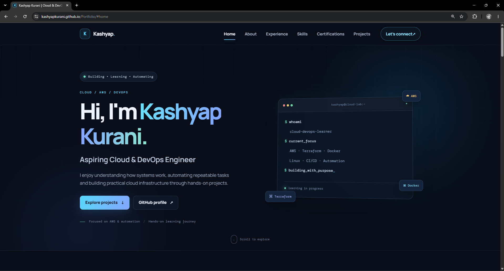
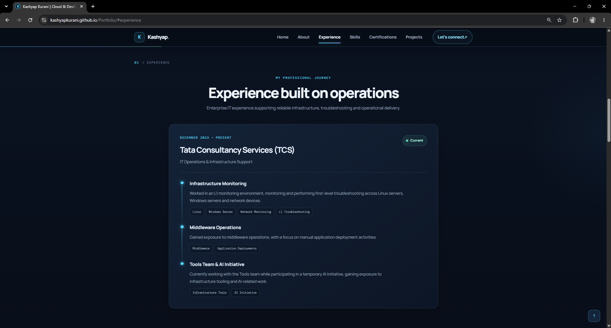
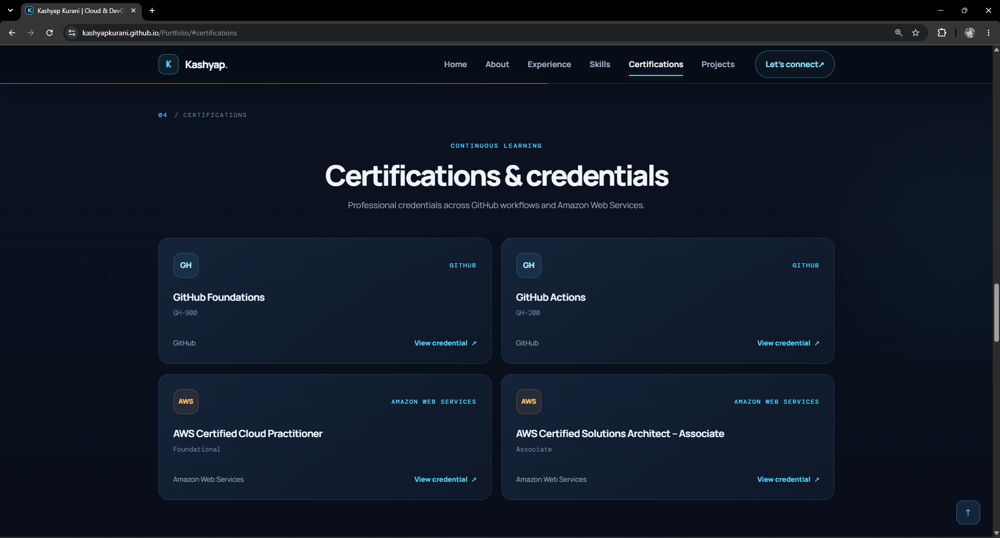
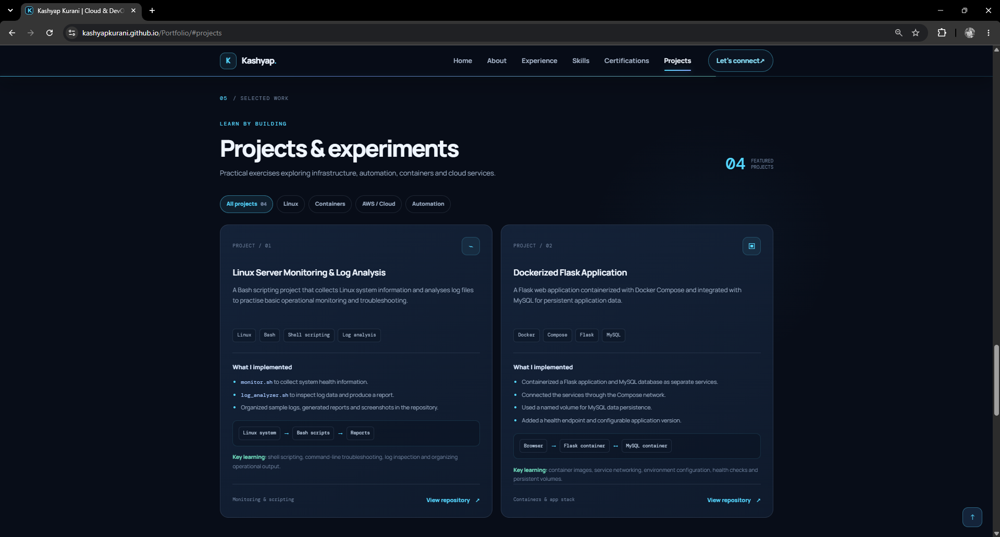
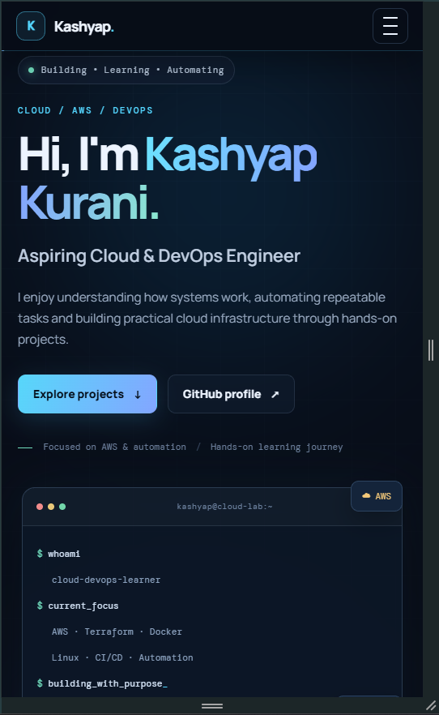

# Kashyap Kurani | Cloud & DevOps Engineer

<p align="center">
  
</p>

<h3 align="center">Personal Portfolio Website</h3>

<p align="center">
  Showcasing my professional experience, technical skills, certifications, and hands-on projects in Cloud Computing and DevOps.
</p>

<p align="center">
  <a href="https://kashyapkurani.github.io/Portfolio/">🌐 Live Portfolio</a> •
  <a href="https://github.com/KashyapKurani">GitHub Profile</a> •
  <a href="https://www.linkedin.com/in/kashyapkurani/">LinkedIn</a>
</p>

---

## 📌 Overview

This repository contains my personal portfolio website, built to showcase my professional journey, technical expertise, certifications, and practical projects.

The portfolio highlights my experience in IT operations and infrastructure support, along with my learning journey toward Cloud Engineering and AWS DevOps.

The website is designed with a modern dark-themed interface, responsive layouts, interactive elements, and smooth animations.

## ✨ Features

- Modern dark-themed user interface
- Responsive design for desktop and mobile devices
- Interactive navigation and smooth scrolling
- Professional About section
- Work Experience timeline
- Technical Skills showcase
- Certifications with credential verification links
- Hands-on Projects showcase
- Contact and social media links
- Custom favicon
- Hover effects and animations

## 🛠️ Tech Stack

| Technology | Purpose |
|---|---|
| HTML5 | Website structure |
| CSS3 | Styling, animations and responsive layouts |
| JavaScript | Interactivity and dynamic behavior |
| Git | Version control |
| GitHub | Source code management |
| GitHub Pages | Static website hosting |

## 💼 Work Experience

### Tata Consultancy Services (TCS)

**IT Operations & Infrastructure Support**

December 2023 – Present

Experience across multiple teams and responsibilities:

- **Infrastructure Monitoring:** L1 monitoring and troubleshooting of Linux servers, Windows servers and network devices.
- **Middleware Operations:** Exposure to middleware environments and manual application deployments.
- **Tools & AI Initiatives:** Working with infrastructure tools and gaining exposure to infrastructure architecture and AI-related initiatives.

## 🏆 Certifications

| Certification | Issuer | Credential |
|---|---|---|
| GitHub Foundations (GH-900) | GitHub | [Verify](https://lnkd.in/p/ddz7GZNu) |
| GitHub Actions (GH-200) | GitHub | [Verify](https://lnkd.in/p/daxGJVr7) |
| AWS Certified Cloud Practitioner | AWS | [Verify](https://lnkd.in/p/d3ku4N42) |
| AWS Certified Solutions Architect – Associate | AWS | [Verify](https://lnkd.in/p/dSu9ZwuE) |

## 🚀 Projects

My portfolio includes hands-on projects focused on Linux, automation, AWS, Infrastructure as Code, containers and CI/CD.

Explore the individual project repositories through my [GitHub profile](https://github.com/KashyapKurani).

## 📸 Website Screenshots

### Home Page


### Work Experience


### Certifications


### Projects


### Mobile Responsive View


## 📂 Project Structure

```text
Portfolio/
│
├── assets/
│   └── favicon.svg
│
├── css/
│   └── style.css
│
├── js/
│   └── script.js
│
├── screenshots/
│   ├── home.png
│   ├── experience.png
│   ├── certifications.png
│   ├── projects.png
│   └── mobile-view.png